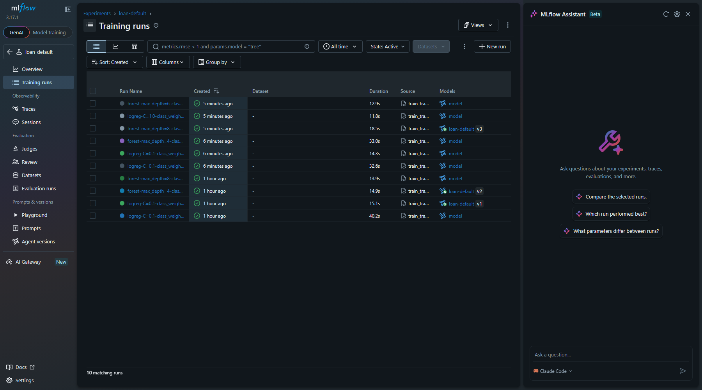
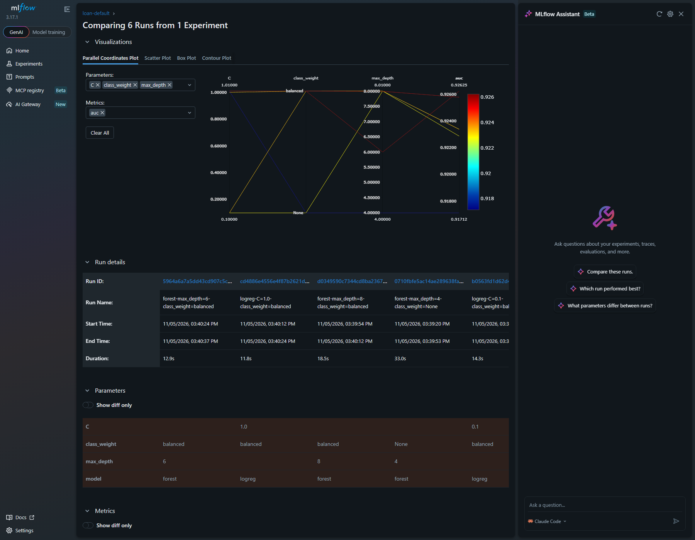
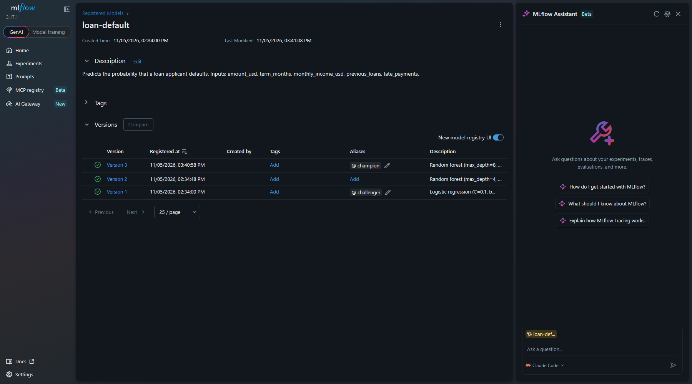
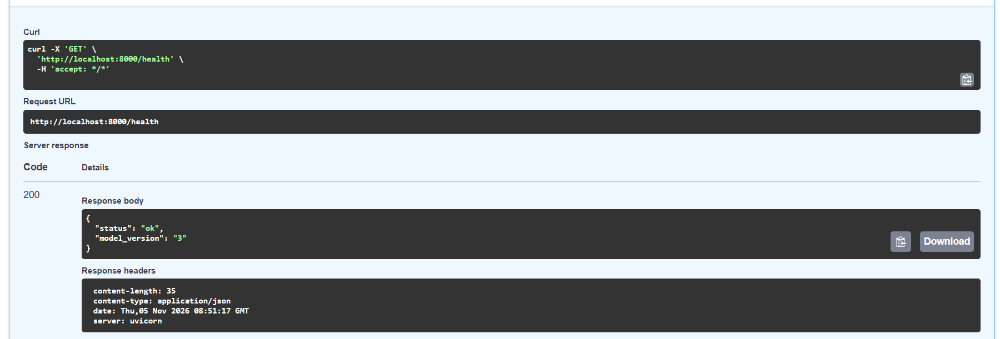
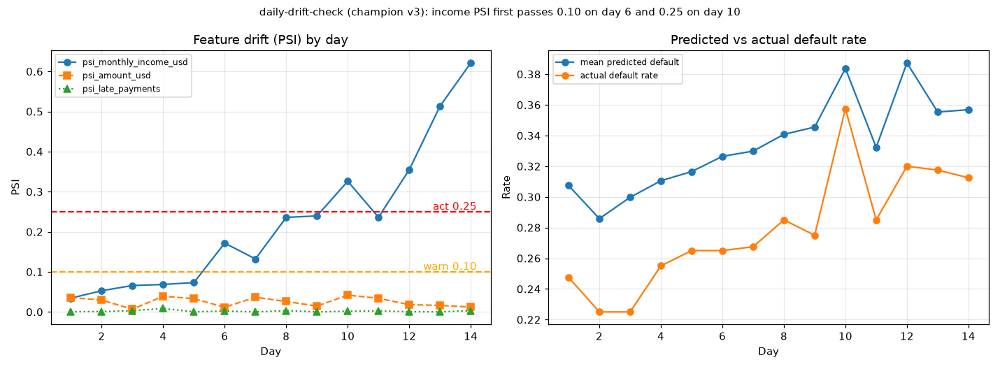
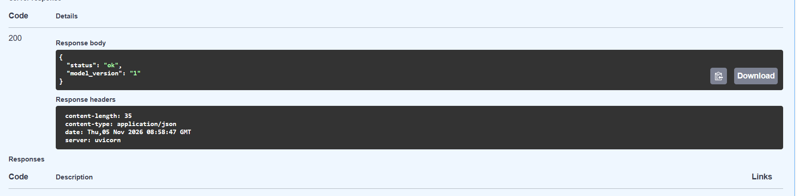
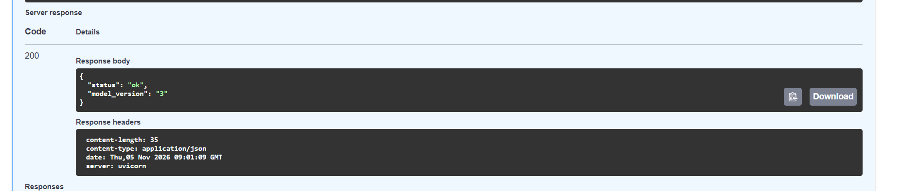

# loan-default: MLflow lifecycle report

Tracking server: `http://127.0.0.1:5000` · Registered model: `loan-default` · Champion: **v3** · Challenger: **v1**

Run links below open in the tracking UI while the server is running.

## 1. Tracked runs (experiment `loan-default`)

Six candidates across two model types, trained by `train_tracked.py` (80/20 split, seed 42, threshold 0.5).

| Run | Model | AUC | Recall | Precision |
|---|---|---|---|---|
| logreg-C=0.1-class_weight=None | logistic regression | 0.923 | 0.707 | 0.813 |
| logreg-C=0.1-class_weight=balanced | logistic regression | 0.923 | 0.865 | 0.610 |
| logreg-C=1.0-class_weight=balanced | logistic regression | 0.923 | 0.865 | 0.611 |
| forest-max_depth=4-class_weight=None | random forest | 0.917 | 0.608 | 0.877 |
| forest-max_depth=6-class_weight=balanced | random forest | 0.926 | 0.806 | 0.728 |
| forest-max_depth=8-class_weight=balanced | random forest | 0.926 | 0.779 | 0.769 |

The experiment holds 10 runs because the first four candidates were trained once before the script was extended and again with it. Duplicates have identical metrics.

**Evidence:** experiment table and comparison chart.




## 2. Registry

| Version | Model | Alias | Run |
|---|---|---|---|
| v3 | forest, depth 8, balanced | `champion` | [d0349590](http://127.0.0.1:5000/#/experiments/1/runs/d0349590c7344cd8ba2367b9c9903aeb) |
| v1 | logistic regression, C=0.1, balanced | `challenger` | [b3454d45](http://127.0.0.1:5000/#/experiments/1/runs/b3454d45bad440e894587125a45bb753) |
| v2 | forest, depth 4, no weights | none (not promoted) | [75fec1d9](http://127.0.0.1:5000/#/experiments/1/runs/75fec1d900f74e5fa4603505e1428229) |

Each version and the registered model carry a description.

**Evidence:** Models > loan-default, showing versions, aliases and descriptions.



## 3. Promotion decision

I promote **v3** (random forest, depth 8, balanced class weights) to champion. It has the best AUC (0.926), catches 77.9% of real defaults (recall 0.779), and 76.9% of the loans it flags really default (precision 0.769). The logistic regression (v1) has higher recall (0.865) but a precision of only 0.610, so roughly four in ten flagged applicants would be good customers wrongly rejected. The shallow forest (v2) has the best precision (0.877) but misses about four in ten defaults (recall 0.608), which is the costlier error for a lender. v1 stays as challenger: it is the simplest model and the one to prefer if the business decides a missed default costs much more than a rejected good applicant. Runs: [v3](http://127.0.0.1:5000/#/experiments/1/runs/d0349590c7344cd8ba2367b9c9903aeb), [v1](http://127.0.0.1:5000/#/experiments/1/runs/b3454d45bad440e894587125a45bb753), [v2](http://127.0.0.1:5000/#/experiments/1/runs/75fec1d900f74e5fa4603505e1428229).

## 4. MLflow scoring server (`models:/loan-default@champion`, port 5001)

Valid request:

```text
$ curl -s http://127.0.0.1:5001/invocations -H "Content-Type: application/json" \
    -d '{"dataframe_records":[{"amount_usd":1500,"term_months":12,"monthly_income_usd":350.0,"previous_loans":1,"late_payments":0}]}'
{"predictions": [[0.9342560176846996, 0.06574398231530053]]}
```

Rejected by the signature (misspelled column `late_payment`):

```text
{"error_code": "INVALID_PARAMETER_VALUE", "message": "... Model is missing inputs ['late_payments']. Note that there were extra inputs: ['late_payment'].", "error_class": "SCHEMA_ENFORCEMENT_FAILED"}
```

Also tested: `"amount_usd": "1500"` is accepted (converts safely); `"amount_usd": "fifteen hundred"` is rejected (`Failed to convert column amount_usd to type 'int64'`).

**Same probability from both servers** for the same applicant (column 1 is the default probability):

| Server | Default probability |
|---|---|
| MLflow scoring server (5001) | 0.0657 |
| FastAPI `/api/v1/predictions` | 0.066 (`model_version` "3") |

## 5. FastAPI loads by alias

`main.py` loads `models:/loan-default@champion` at start-up (no file path, no version number) and `/health` reports the version the alias points to:

```text
$ curl -s http://127.0.0.1:8001/health
{"status":"ok","model_version":"3"}
```

**Evidence:** `/health` on port 8000 after restarting FastAPI with `champion` on v3.



## 6. Drift monitoring (14 simulated days, champion v3)

Run: [daily-drift-check](http://127.0.0.1:5000/#/experiments/2/runs/c9706ecbada343e981fc804e1416ee26). Income PSI by day:

`0.034, 0.053, 0.066, 0.069, 0.073, 0.172, 0.132, 0.236, 0.240, 0.326, 0.236, 0.355, 0.513, 0.621`

`psi_amount_usd` never exceeded 0.042 and `psi_late_payments` never exceeded 0.009, so the drift is in income only. Actual default rate rose from 0.247 to about 0.31 over the same period.

**Alert plan** (thresholds are justified by this chart):

| Level | Rule | Why this value | First fires |
|---|---|---|---|
| Warn | any feature PSI > 0.10 | Days 1-5 never exceeded 0.073, so 0.10 sits above normal day-to-day noise from a 400-applicant sample. | Day 6 (0.172) |
| Act: investigate and retrain | 3-day average PSI > 0.25 | A single-day rule is noisy: day 11 dipped back to 0.236 after day 10 hit 0.326. The 3-day average avoids false alarms and still fires on day 10 (0.267). | Day 10 |
| Watch | actual default rate more than 20% above its baseline | Confirms drift is hurting outcomes, not just inputs. | Day 10 (0.357 vs 0.247) |

**Evidence:** the logged metrics plotted with the 0.10 and 0.25 thresholds marked.



## 7. Rollback

`champion` moved v3 to v1, FastAPI restarted, then moved back to v3 and restarted.

```text
BEFORE                    : {"status":"ok","model_version":"3"}
alias moved, no restart   : {"status":"ok","model_version":"3"}   <- still serving v3
AFTER rollback restart    : {"status":"ok","model_version":"1"}
AFTER move back + restart : {"status":"ok","model_version":"3"}
```

The API loads the model once at start-up, so an alias move only takes effect after a restart.

**Evidence:** `/health` on port 8000, before (08:51:17 GMT) and after the rollback restart (08:58:47 GMT).

Before (`champion` on v3):


After moving `champion` to v1 and restarting:



After moving `champion` back to v3 and restarting (09:01:09 GMT):


